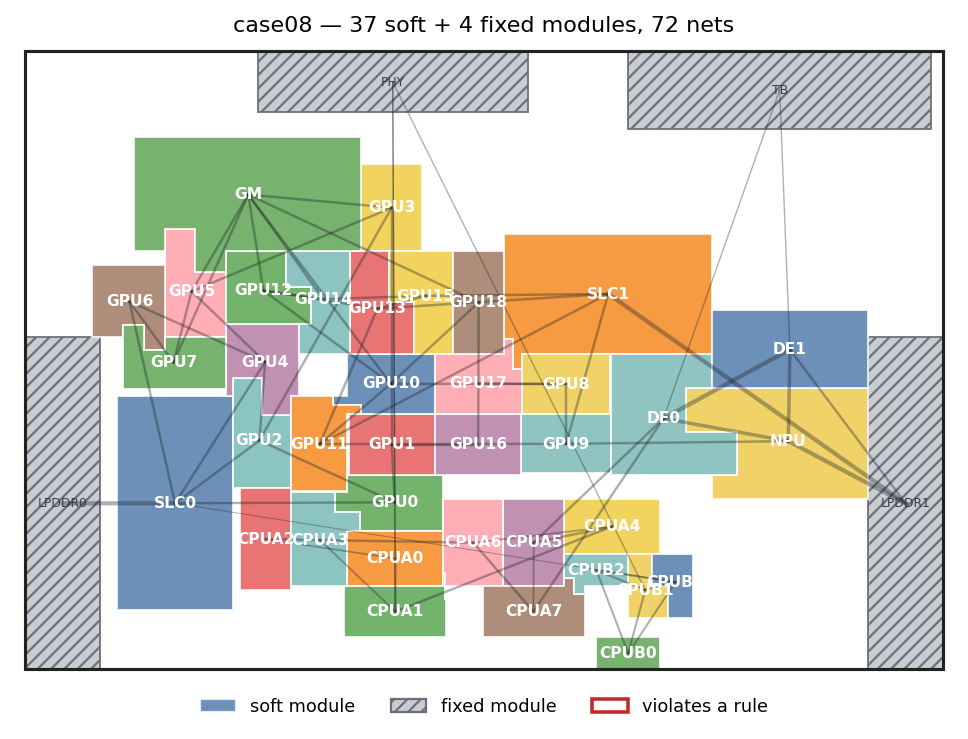
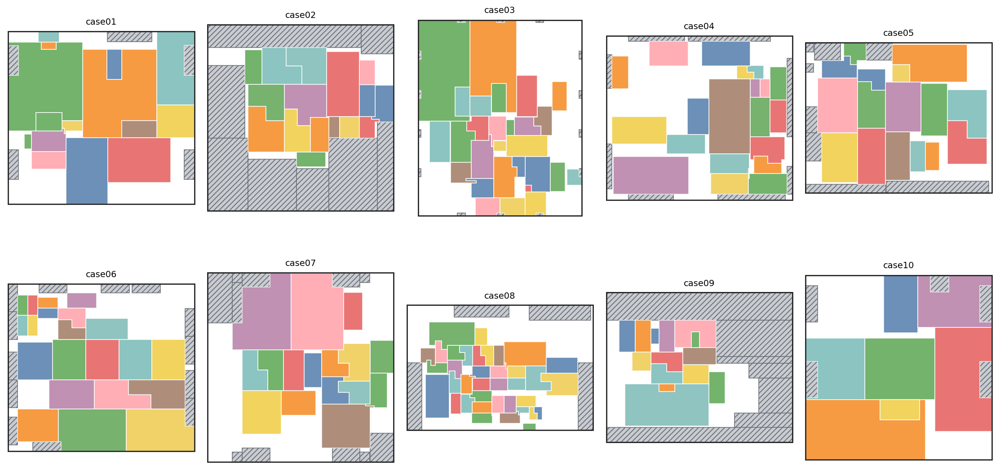
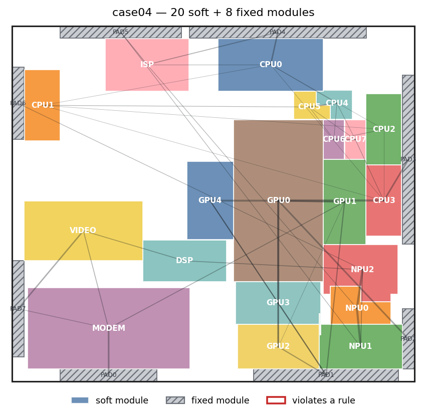

# Rectilinear Floorplanner

<p align="center">
  
</p>

A C++ floorplanner for **fixed-outline, rectilinear floorplanning** with soft
and fixed modules (ICCAD 2023 CAD Contest, Problem D).

Soft modules start as rectangles chosen by an LP, are optimised by simulated
annealing on a **sequence pair**, and are finally **interlocked** into
rectilinear shapes (an MIP decides which neighbouring modules exchange a
"hand"), which shortens the wirelength further.

## ✨ Features
- Fixed-outline floorplanning with soft modules (area, aspect ratio 1:2–2:1,
  ≥ 80 % bounding-box utilisation) and fixed modules
- Sequence-pair representation, LP based shape/position optimisation (GLPK)
- Multi-threaded simulated annealing
- Rectilinear (interlocked) modules for additional wirelength reduction
- Input formats: **ICCAD 2023 Problem D** and [MCNC](http://www.cbl.ncsu.edu/benchmarks/)
- Plotting: interactive (gnuplot) or to image files (`scripts/plot_floorplan.py`)

## 📊 Results

Final floorplans of the ten contest test cases (`-s 1`, 60 s of annealing).
Hatched: fixed modules.



| Case | Soft / fixed modules | Nets | HPWL (rectangular) | HPWL (rectilinear) | Gain | Legal |
|------|---------------------:|-----:|-------------------:|-------------------:|-----:|:-----:|
| case01 | 15 / 5  | 45  | 189,156,843 | 188,819,513 | 0.18 % | ✓ |
| case02 | 16 / 8  | 39  | 24,626,943 | 24,261,611 | 1.48 % | ✓ |
| case03 | 28 / 14 | 108 | 3,048,528 | 3,017,500 | 1.02 % | ✓ |
| case04 | 20 / 8  | 47  | 84,470,350 | 83,884,450 | 0.69 % | ✓ |
| case05 | 16 / 8  | 33  | 23,284,450 | 22,934,850 | 1.50 % | ✓ |
| case06 | 21 / 13 | 56  | 65,184,950 | 64,780,750 | 0.62 % | ✓ |
| case07 | 16 / 11 | 39  | 459,462,850 | 450,683,850 | 1.91 % | ✓ |
| case08 | 37 / 4  | 72  | 153,765,900 | 150,457,400 | 2.15 % | ✓ |
| case09 | 14 / 7  | 19  | 91,095,250 | 90,855,250 | 0.26 % | ✓ |
| case10 | 7 / 5   | 11  | 21,454,300 | 21,454,300 | 0.00 % | ✓ |

*HPWL (rectangular)*: wirelength of the annealed floorplan; *HPWL
(rectilinear)*: after interlocking. All ten floorplans are legal. Each run took 60–100 s. The annealing is
multi-threaded, so results vary between runs even with the same seed.

<p align="center">
  
</p>

## 📂 Project Structure
```
.
├── src/
│   ├── main.cpp          # Entry point (command line)
│   ├── process/          # Solver flow, simulated annealing, sequence pair + LP models
│   ├── static_data/      # Chip / module / net data and input parsers
│   ├── bounding/         # Rectilinear polygons (bounding lines) and boolean operations
│   ├── utilities/        # Geometry primitives (vec2d, line, rect, ...)
│   ├── plugin/           # gnuplot visualizer, argument parser
│   ├── output_data/      # Output utilities
│   └── polygon/          # Polygon helpers
├── scripts/plot_floorplan.py   # Render floorplans to PNG / SVG
├── testcase/             # ICCAD 2023 Problem D test cases
├── mcncbenchmark/        # MCNC benchmarks
└── glpk-5.0/             # Vendored GLPK static libraries
```

Key files:
- **process/solver_t** – the overall flow (initialisation → annealing → interlocking)
- **process/SA_solver_t** – simulated annealing with parallel neighbour search
- **process/sequence_pair/sequence_pair_t** – sequence pair, LP placement, interlocking
- **process/sequence_pair/sp_ilp_settings_t** – the LP / MIP models
- **process/functional/ILP_solver_t** – thin GLPK wrapper
- **static_data/chip_t** – chip, modules and nets; file input

## ⚙️ Build
Requires a C++17 compiler, CMake ≥ 3.18 and the GLPK 5.0 header (`glpk.h`).
The static libraries are vendored in `glpk-5.0/lib`; the header is looked up in
`glpk-5.0/include`, Homebrew and the system include paths.

```bash
# macOS: brew install glpk      Ubuntu >= 22.04: sudo apt install libglpk-dev
cmake -S . -B build             # Release build by default
cmake --build build -j
```

The header must be from GLPK **5.0** to match the vendored libraries (older
distributions ship 4.x; use the header of the
[GLPK 5.0 sources](https://ftp.gnu.org/gnu/glpk/glpk-5.0.tar.gz), `src/glpk.h`).

If `glpk.h` is somewhere else, pass `-DGLPK_INCLUDE_DIR=<dir>`; for a debug
build add `-DCMAKE_BUILD_TYPE=Debug`.

## 🚀 Usage
```bash
./build/src/floorplanner -i <input> [-o <output dir>] [-s <seed>] [-t]
```

| Option | Description |
|--------|-------------|
| `-i <input>` | Input file (ICCAD 2023 Problem D format) |
| `-o <dir>` | Directory for `check.txt` (default: current directory) |
| `-s <seed>` | Random seed (default: random; the seed is printed) |
| `-t` | Run the built-in predetermined sequence pair of a known test case instead of the solver |

Example:
```bash
mkdir -p out/case08
./build/src/floorplanner -i testcase/case08-input.txt -o out/case08 -s 1
```

## 📜 Output
- `<output dir>/check.txt` – one line per soft module (name, legality, area,
  aspect ratio, utilisation, vertex/edge counts, polygon), followed by the
  rectilinear wirelength and the total numbers of vertices, edges and 270°
  vertices
- Console log of the annealing and the final wirelengths
- gnuplot windows of the intermediate and final floorplans (skipped with a
  warning if gnuplot is not installed)

To render a result to an image (requires `matplotlib`):
```bash
python3 scripts/plot_floorplan.py single --input testcase/case08-input.txt \
    --check out/case08/check.txt --out case08.png --nets --labels
```
`scripts/plot_floorplan.py gallery` renders several results side by side
(this is how the figures above were made).

## 🧩 Legalisation
After interlocking, a module may violate the shape rules (aspect ratio 1:2 – 2:1,
≥ 80 % of its bounding box). Only those modules are repaired, reverting as
little as possible: first the interlock of the module is dropped; if it is
still illegal, the single overlap that cuts away most of its area is
forbidden and the floorplan is re-solved (repeated until legal). All other
interlocks and overlaps are kept.

## ⚠️ Known Issues
- In rare cases no overlap of an illegal module can be forbidden without
  making the floorplan infeasible; the module then stays illegal (reported by
  the final check).
- A module lying entirely inside another one (no crossing edges) is not
  subtracted during the overlap removal, because the result would need a hole.

## 🔮 Future Work
- Resolve overlaps that would require holes
- Integration with open-source EDA flows (e.g., OpenROAD)
